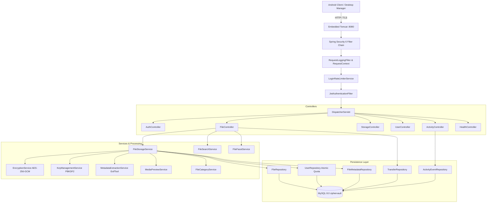

# CIPHERVAULT — BACKEND, REST API & DATABASE REFERENCE

**Document ID:** `CIPHERVAULT_BACKEND_API_DATABASE_REFERENCE.md`  
**Location:** `docs/reference/CIPHERVAULT_BACKEND_API_DATABASE_REFERENCE.md`  
**Backend Framework:** Spring Boot 3.3.4 (Java 21 LTS, Embedded Tomcat 10.1.30, Spring Security 6.3.3)  
**Persistence:** MySQL 8.0 Community Server + Hibernate 6.5.3 (HikariCP)  
**Host Binding:** `0.0.0.0:8080`  

---

## 1. Backend Architecture & Component Flow



---

## 2. Exhaustive REST API Specification

### 2.1 Authentication & Profile APIs (`/api/auth`, `/api/user`)

#### 1. Register Account
- **Route:** `POST /api/auth/register`
- **Auth:** Public
- **Request Body (JSON):**
  ```json
  {
    "name": "Jane Doe",
    "username": "janedoe",
    "email": "jane@example.com",
    "password": "StrongPassword@2026"
  }
  ```
- **Validation Rules:**
  - `name`: Non-blank, max 255 chars.
  - `username`: Non-blank, unique in database.
  - `email`: Non-blank, normalized to lowercase, unique in database.
  - `password`: Minimum 8 chars, at least 1 uppercase, 1 lowercase, 1 digit, 1 special character.
- **Success Response:** `200 OK`
  ```json
  {
    "message": "User registered successfully",
    "username": "janedoe",
    "email": "jane@example.com"
  }
  ```
- **Failure Responses:**
  - `400 Bad Request`: `{"message": "Username already exists"}`
  - `400 Bad Request`: `{"message": "Email already exists"}`
  - `400 Bad Request`: `{"message": "Password must contain at least one special symbol"}`

#### 2. User Sign-In (Multi-Identifier: Email or Username)
- **Route:** `POST /api/auth/login`
- **Auth:** Public
- **Rate Limiting:** IP + Identifier based sliding window. 5 consecutive failures triggers a 15-minute lockout with HTTP 429.
- **Request Body (JSON):**
  ```json
  {
    "identifier": "janedoe",
    "password": "StrongPassword@2026"
  }
  ```
  *(Note: Accepts `identifier`, `usernameOrEmail`, `username`, or `email` fields).*
- **Success Response:** `200 OK`
  ```json
  {
    "success": true,
    "message": "Login successful",
    "token": "eyJhbGciOiJIUzI1NiIsInR5cCI6IkpXVCJ9...",
    "username": "janedoe",
    "email": "jane@example.com",
    "name": "Jane Doe"
  }
  ```
- **Failure Responses:**
  - `401 Unauthorized`: `"Invalid email or password"`
  - `429 Too Many Requests`: `{"success": false, "message": "Too many failed login attempts. Please wait 15 minute(s) before trying again."}` with header `Retry-After: 900`.

#### 3. Change Master Password
- **Route:** `POST /api/auth/change-password` or `PUT /api/auth/change-password`
- **Auth:** `Bearer <token>`
- **Request Body (JSON):**
  ```json
  {
    "currentPassword": "OldPassword@2026",
    "newPassword": "NewPassword@2026",
    "confirmPassword": "NewPassword@2026"
  }
  ```
- **Behavior:** Validates old password, applies new BCrypt hash, increments `token_version` to invalidate existing tokens, generates and returns fresh token.
- **Success Response:** `200 OK` (`{"success": true, "message": "Password changed successfully", "token": "..."}`)

#### 4. Secure Sign-Out
- **Route:** `POST /api/auth/logout`
- **Auth:** `Bearer <token>`
- **Behavior:** Increments `token_version` in `users` table, rendering the client's current JWT immediately invalid on all endpoints.
- **Success Response:** `200 OK` (`{"success": true, "message": "Logged out successfully"}`)

---

### 2.2 File Management & Streaming APIs (`/api/files`)

#### 5. Encrypted File Upload
- **Route:** `POST /api/files/upload`
- **Auth:** `Bearer <token>`
- **Content-Type:** `multipart/form-data`
- **Form Part:** `file` (MultipartFile)
- **Processing Pipeline:**
  1. Temporary source streaming to disk.
  2. **1 GB File Limit Check:** If `fileSize > 1,073,741,824 bytes` -> Throws `IllegalArgumentException` (`400 Bad Request`).
  3. **10 GB Pre-Storage Check:** If `usedStorage + fileSize > storageLimit` -> Throws `StorageQuotaExceededException` (`507 Insufficient Storage`).
  4. SHA-256 calculation.
  5. User-scoped duplicate check -> Throws `DuplicateFileException` (`409 Conflict`).
  6. Thumbnail preview generation (JPEG).
  7. ExifTool technical metadata extraction.
  8. AES-256-GCM streaming encryption with user key.
  9. **Atomic SQL Quota Reservation:** `UPDATE users SET used_storage = used_storage + :delta WHERE id = :userId AND (used_storage + :delta) <= storage_limit`. If 0 rows updated -> Rollback disk files and throw `StorageQuotaExceededException`.
  10. StoredFile and FileMetadata persistence.
- **Success Response:** `200 OK`
  ```json
  {
    "success": true,
    "message": "File uploaded successfully",
    "fileId": 142,
    "filename": "camera_sample.jpg",
    "fileSize": 4194304,
    "encrypted": true,
    "sha256Hash": "e3b0c44298fc1c149afbf4c8996fb92427ae41e4649b934ca495991b7852b855"
  }
  ```
- **Failure Responses:**
  - `400 Bad Request`: `{"message": "File exceeds the maximum allowable upload limit of 1 GB"}`
  - `409 Conflict`: `{"success": false, "message": "Duplicate file already exists", "sha256Hash": "..."}`
  - `507 Insufficient Storage`: `{"success": false, "message": "Storage quota exceeded"}`

#### 6. List Stored Files
- **Route:** `GET /api/files`
- **Auth:** `Bearer <token>`
- **Query Params:**
  - `page` (optional int, default 0)
  - `size` (optional int, default 50, max 100)
  - `sort` (optional string: `newest`, `oldest`, `largest`, `smallest`, `name`)
- **Headers Returned:**
  - `X-Total-Count`: Total files count
  - `X-Total-Pages`: Total pagination pages
  - `X-Current-Page`: Current page index
  - `X-Page-Size`: Items per page
- **Success Response:** `200 OK` (Array of `FileResponse` objects including metadata DTOs).

#### 7. Stream Decrypted File Download
- **Route:** `GET /api/files/{id}/download` (or `GET /api/files/download/{id}`)
- **Auth:** `Bearer <token>`
- **Query Params:** `decrypt` (boolean, default `true`)
- **Headers Returned:**
  - `Content-Type`: Original MIME type (e.g., `image/jpeg`, `application/pdf`)
  - `Content-Disposition`: `attachment; filename="original_name.ext"`
  - `Content-Length`: Decrypted byte size
  - `X-File-SHA256`: Expected SHA-256 hash
  - `X-Encrypted`: `true`
- **Success Response:** `200 OK` with streaming binary body.

#### 8. Retrieve File Thumbnail Preview
- **Route:** `GET /api/files/{id}/preview` (or `GET /api/files/preview/{id}`)
- **Auth:** `Bearer <token>`
- **Headers Returned:** `Content-Type: image/jpeg`, `Cache-Control: private, max-age=86400`
- **Success Response:** `200 OK` (Binary JPEG thumbnail data).

#### 9. Delete Stored File & Reclaim Quota
- **Route:** `DELETE /api/files/{id}`
- **Auth:** `Bearer <token>`
- **Behavior:**
  1. Validates ownership: `findByIdAndUser(id, user)`.
  2. Deletes physical ciphertext file from `storage/encrypted/`.
  3. Deletes preview file from `storage/previews/` if present.
  4. Atomically decrements used storage: `decrementStorageUsedAtomic(userId, fileSize)`.
  5. Cascades database deletion to `file_metadata`.
  6. Logs activity event.
- **Success Response:** `200 OK`
  ```json
  {
    "success": true,
    "message": "File deleted successfully",
    "fileId": 142
  }
  ```

#### 10. Check SHA-256 Duplicate Pre-Upload
- **Route:** `GET /api/files/check-duplicate`
- **Auth:** `Bearer <token>`
- **Query Params:** `hash` (64-char hex SHA-256)
- **Success Response:** `200 OK`
  ```json
  {
    "isDuplicate": true,
    "existingFileName": "sample.jpg",
    "fileId": 142
  }
  ```

---

### 2.3 Metadata Search & Dynamic Cascading Facets APIs

#### 11. Retrieve Dynamic Cascading Facets
- **Route:** `GET /api/files/facets`
- **Auth:** `Bearer <token>`
- **Query Parameters:** `query`, `category`, `cameraMake`, `cameraModel`, `resolution`, `codec`, `artist`, `author`, `genre`, `lens`, `minSize`, `maxSize`, `dateTaken`.
- **Behavior:** Returns only distinct metadata values and accurate counts based exclusively on files owned by the authenticated user matching current filters.
- **Success Response:** `200 OK`
  ```json
  {
    "totalMatchingFiles": 15,
    "facets": [
      {
        "field": "category",
        "label": "File Type",
        "available": true,
        "values": [
          {"value": "IMAGES", "label": "Photos", "count": 12},
          {"value": "VIDEOS", "label": "Videos", "count": 3}
        ]
      },
      {
        "field": "cameraMake",
        "label": "Camera Brand",
        "available": true,
        "values": [
          {"value": "Canon", "label": "Canon", "count": 8},
          {"value": "Sony", "label": "Sony", "count": 4}
        ]
      }
    ]
  }
  ```

#### 12. Search Files by Metadata
- **Route:** `GET /api/files/search`
- **Auth:** `Bearer <token>`
- **Query Parameters:** Same as `/api/files/facets` plus pagination (`page`, `size`).
- **Success Response:** `200 OK` (List of matching `FileResponse` objects with metadata).

---

### 2.4 Storage Accounting APIs (`/api/storage`)

#### 13. Authoritative Storage Summary
- **Route:** `GET /api/storage/summary`
- **Auth:** `Bearer <token>`
- **Success Response:** `200 OK`
  ```json
  {
    "totalBytes": 10737418240,
    "usedBytes": 2147483648,
    "availableBytes": 8589934592,
    "usagePercentage": 20.0,
    "percentage": 20.0,
    "fileCount": 42
  }
  ```

#### 14. Storage Category Breakdown
- **Route:** `GET /api/storage/categories`
- **Auth:** `Bearer <token>`
- **Success Response:** `200 OK` (Array with byte counts and percentage for Photos, Videos, Documents, Audio, Archives, Other).

---

## 3. Database Schema, Constraints & Indexes

```sql
-- MySQL 8.0 DDL Summary
CREATE TABLE users (
    id BIGINT AUTO_INCREMENT PRIMARY KEY,
    name VARCHAR(255) NOT NULL,
    username VARCHAR(255) NOT NULL UNIQUE,
    email VARCHAR(255) NOT NULL UNIQUE,
    password VARCHAR(255) NOT NULL,
    storage_limit BIGINT NOT NULL DEFAULT 10737418240, -- 10 GB
    used_storage BIGINT NOT NULL DEFAULT 0,
    user_key VARCHAR(512) NULL,
    token_version INT NOT NULL DEFAULT 1,
    profile_photo_path VARCHAR(512) NULL,
    created_at DATETIME NOT NULL DEFAULT CURRENT_TIMESTAMP,
    INDEX idx_users_username (username),
    INDEX idx_users_email (email)
);

CREATE TABLE stored_files (
    id BIGINT AUTO_INCREMENT PRIMARY KEY,
    user_id BIGINT NOT NULL,
    original_filename VARCHAR(255) NOT NULL,
    stored_filename VARCHAR(255) NOT NULL,
    file_size BIGINT NOT NULL,
    content_type VARCHAR(255) NOT NULL,
    sha256_hash VARCHAR(64) NOT NULL,
    storage_path VARCHAR(512) NOT NULL,
    encrypted BOOLEAN NOT NULL DEFAULT TRUE,
    has_preview BOOLEAN NOT NULL DEFAULT FALSE,
    preview_path VARCHAR(512) NULL,
    preview_mime_type VARCHAR(100) NULL,
    created_at DATETIME NOT NULL DEFAULT CURRENT_TIMESTAMP,
    CONSTRAINT fk_stored_files_user FOREIGN KEY (user_id) REFERENCES users(id) ON DELETE CASCADE,
    CONSTRAINT uq_stored_files_user_sha256 UNIQUE (user_id, sha256_hash),
    INDEX idx_files_user (user_id),
    INDEX idx_files_user_created (user_id, created_at DESC),
    INDEX idx_files_user_size (user_id, file_size DESC),
    INDEX idx_files_user_sha256 (user_id, sha256_hash)
);

CREATE TABLE file_metadata (
    id BIGINT AUTO_INCREMENT PRIMARY KEY,
    file_id BIGINT NOT NULL UNIQUE,
    camera_make VARCHAR(255) NULL,
    camera_model VARCHAR(255) NULL,
    lens VARCHAR(255) NULL,
    resolution VARCHAR(100) NULL,
    video_codec VARCHAR(100) NULL,
    audio_codec VARCHAR(100) NULL,
    -- ... (28 technical Exif fields)
    CONSTRAINT fk_file_metadata_stored_file FOREIGN KEY (file_id) REFERENCES stored_files(id) ON DELETE CASCADE
);

CREATE TABLE activity_events (
    id BIGINT AUTO_INCREMENT PRIMARY KEY,
    user_id BIGINT NOT NULL,
    event_type VARCHAR(50) NOT NULL,
    timestamp DATETIME NOT NULL DEFAULT CURRENT_TIMESTAMP,
    summary VARCHAR(500) NULL,
    file_count INT NULL,
    total_bytes BIGINT NULL,
    affected_files TEXT NULL,
    status VARCHAR(50) NULL,
    error_message VARCHAR(500) NULL,
    CONSTRAINT fk_activity_events_user FOREIGN KEY (user_id) REFERENCES users(id) ON DELETE CASCADE,
    INDEX idx_activity_user (user_id),
    INDEX idx_activity_user_time (user_id, timestamp DESC)
);

CREATE TABLE transfers (
    id BIGINT AUTO_INCREMENT PRIMARY KEY,
    user_id BIGINT NOT NULL,
    transfer_type VARCHAR(50) NOT NULL,
    status VARCHAR(50) NOT NULL,
    total_bytes BIGINT NULL,
    transferred_bytes BIGINT NULL,
    file_ids VARCHAR(255) NULL,
    file_names TEXT NULL,
    started_at DATETIME NOT NULL DEFAULT CURRENT_TIMESTAMP,
    completed_at DATETIME NULL,
    CONSTRAINT fk_transfers_user FOREIGN KEY (user_id) REFERENCES users(id) ON DELETE CASCADE,
    INDEX idx_transfers_user (user_id),
    INDEX idx_transfers_user_time (user_id, started_at DESC)
);
```

---

## 4. Build, Configuration & Run Commands

### 4.1 Environment Variables
| Variable | Default Value | Description |
|---|---|---|
| `CIPHERVAULT_DB_USERNAME` | `ciphervault_user` | MySQL database username |
| `CIPHERVAULT_DB_PASSWORD` | `CipherVault@2026` | MySQL database password |
| `CIPHERVAULT_JWT_SECRET` | *(auto-generated dev)* | HMAC-SHA256 signing secret |
| `CIPHERVAULT_MASTER_KEY` | *(auto-generated dev)* | AES-256 envelope master key |
| `CIPHERVAULT_ENV` | `development` | Deployment environment profile |

### 4.2 Commands
```powershell
# 1. Compile backend
cd backend
.\mvnw.cmd test-compile

# 2. Run all unit and integration tests (138 tests)
.\mvnw.cmd test

# 3. Package executable JAR
.\mvnw.cmd clean package -DskipTests

# 4. Start backend server
.\mvnw.cmd spring-boot:run
```

