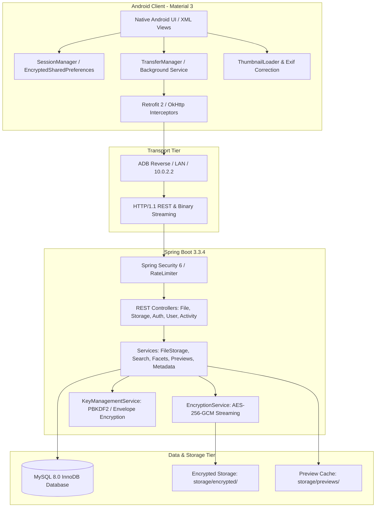
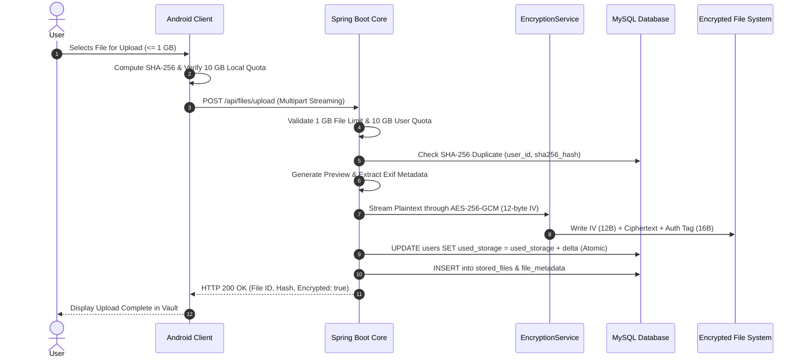

# CIPHERVAULT — COMPREHENSIVE SYSTEM ARCHITECTURE

**Document ID:** `CIPHERVAULT_SYSTEM_ARCHITECTURE.md`  
**Location:** `docs/architecture/CIPHERVAULT_SYSTEM_ARCHITECTURE.md`  
**System Type:** Sovereign Private Encrypted Cloud Storage & Media Vault  
**Platforms:** Android Client (Material 3 Native) + Spring Boot 3 Core + MySQL 8.0 + Desktop Server Manager  

---

## 1. System Context & High-Level Architecture

CipherVault is designed to provide high-performance, private, zero-knowledge storage for mobile clients connecting to a self-hosted backend. The architecture eliminates plaintext data persistence on host file systems and provides deep metadata search, thumbnail caching, and automated duplicate prevention.



---

## 2. Android Client Architecture

### 2.1 Architectural Pattern
- **Presentation Layer:** Native Android Java Activities and Fragments with XML Views. Adheres to Google Material 3 Design System (Warm cream, peach, brown color scheme).
- **Navigation Architecture:** Single-activity hosting with Bottom Navigation (`MainActivity` managing `FragmentHome`, `FragmentVault`, `FragmentMetadataSearch`, `FragmentTransfers`, `FragmentSettings`). Back stack coordination handled via `OnBackPressedDispatcher`.
- **System Inset Management:** Edge-to-edge layout enabled across all screens with `ViewCompat.setOnApplyWindowInsetsListener` respecting status bars, navigation bars, and display cutouts.
- **Asynchronous Operations:**
  - Foreground network calls via Retrofit 2 callbacks.
  - Background queueing and streaming transfers via `TransferManager` executing on a dedicated thread pool (`Executors.newFixedThreadPool(3)`).
  - Background notification updates via `TransferNotificationHelper`.
- **Local Security Layer:**
  - Tokens and sensitive session state persisted via `EncryptedSharedPreferences` backed by Android KeyStore AES-256 MasterKey.
  - Optional biometric lock via AndroidX `BiometricPrompt`.

---

## 3. Backend Core Architecture

### 3.1 Layered Architecture
1. **Filter & Security Layer:**
   - `RequestLoggingFilter`: Generates unique ThreadLocal request correlation IDs (`REQ-xxxx`) and logs execution timing.
   - `LoginRateLimiterService`: Guards against brute-force attacks by tracking IP and identifier attempts.
   - `JwtAuthenticationFilter`: Validates HMAC-SHA256 tokens and database `token_version` on every authenticated request.
2. **Controller Layer:**
   - Exposes REST contracts using Spring MVC annotations. Enforces validation constraints and translates exceptions via `GlobalExceptionHandler`.
3. **Service Layer:**
   - Coordinates business logic: streaming encryption, duplicate checks, atomic storage reservation, Exif extraction, and thumbnail generation.
4. **Data Access Layer:**
   - Spring Data JPA repositories with custom transactional queries (`UserRepository.incrementStorageUsedAtomic`, `decrementStorageUsedAtomic`).
   - Hibernate 6.5.3 managing schema updates and relationship mapping.

---

## 4. Cryptographic Envelope Architecture



---

## 5. Storage Quota Enforcement Architecture

- **Authoritative Vault Capacity:** **10 GB** (`10,737,418,240 bytes`).
- **Maximum Selected Batch & Single File Limit:** **1 GB** (`1,073,741,824 bytes`).
- **Atomic Concurrency Protection:**
  The backend avoids race conditions by performing storage reservation directly in the database update statement:
  ```sql
  UPDATE users
  SET used_storage = used_storage + :delta
  WHERE id = :userId
    AND (used_storage + :delta) <= storage_limit;
  ```
  If concurrent requests attempt to exceed the storage quota, the query affects 0 rows, prompting the service to immediately clean up the stored physical blob and reject the upload with `StorageQuotaExceededException` (HTTP 507 Insufficient Storage).

---

## 6. Desktop Server Manager Architecture

Located in `server-control/` at the repository root (launched via `run.bat`), built with Python 3 and PySide6 (Qt):
- **Process Manager:** Starts, monitors, and stops local MySQL and Spring Boot child processes.
- **Log Streamer:** Real-time tailing of backend logs with colorized severity highlights.
- **QR Pairing Engine:** Uses `qrcode` and `Pillow` to generate pairing QR codes encoding the host's active LAN IP and port for seamless mobile onboarding.

