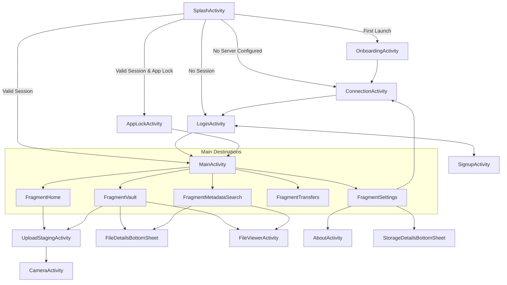

# CIPHERVAULT — COMPLETE SCREEN-BY-SCREEN IMPLEMENTATION REFERENCE

**Document ID:** `CIPHERVAULT_SCREEN_BY_SCREEN_IMPLEMENTATION.md`  
**Location:** `docs/reference/CIPHERVAULT_SCREEN_BY_SCREEN_IMPLEMENTATION.md`  
**Target Platform:** Android (Native Java & XML Views, Material 3, API 26+)  
**Theme Palette:** Warm Cream, Peach, and Brown Design System (`Theme.CipherVault`)  

---

## 1. Overview of Screen Hierarchy & Navigation Map

---

## 2. Screen Specifications

### 2.1 Screen 01: Splash & Initial Router (`SplashActivity`)
- **Identifier:** `SCREEN_SPLASH` — CipherVault Gateway
- **Java Class:** [`com.ciphervault.app.SplashActivity`](file:///c:/Users/akhil/OneDrive/Desktop/CipherVault/android/app/src/main/java/com/ciphervault/app/SplashActivity.java)
- **Layout XML:** [`activity_splash.xml`](file:///c:/Users/akhil/OneDrive/Desktop/CipherVault/android/app/src/main/res/layout/activity_splash.xml)
- **Navigation:**
  - Entry: Android launcher intent (`android.intent.action.MAIN`).
  - Exit Destinations: `OnboardingActivity`, `ConnectionActivity`, `LoginActivity`, `AppLockActivity`, `MainActivity`.
- **View Hierarchy:**
  - Root: `ConstraintLayout` with edge-to-edge system insets.
  - Components: `ImageView` (`ic_shield_logo`), `TextView` ("CipherVault"), `TextView` ("Private Encrypted Cloud"), `LinearProgressIndicator` (indeterminate).
- **Data Model & State Logic:**
  - Checks `OnboardingPreferences.isOnboardingCompleted()`.
  - Checks `ServerConnectionPreferences.isConfigured()`.
  - Checks `SessionManager.isLoggedIn()` and token presence.
  - Checks `CipherVaultPreferences.isBiometricEnabled()`.
- **API Endpoints:** None (asynchronous local preference checks with 800ms minimum splash timer).
- **Security Considerations:** No sensitive tokens exposed or logged.
- **Tests & Evidence:** Covered by `NavigationFoundationTest` and APK launch verification.

---

### 2.2 Screen 02: Onboarding Experience (`OnboardingActivity`)
- **Identifier:** `SCREEN_ONBOARDING` — Welcome Walkthrough
- **Java Class:** [`com.ciphervault.app.onboarding.OnboardingActivity`](file:///c:/Users/akhil/OneDrive/Desktop/CipherVault/android/app/src/main/java/com/ciphervault/app/onboarding/OnboardingActivity.java)
- **Layout XML:** [`activity_onboarding.xml`](file:///c:/Users/akhil/OneDrive/Desktop/CipherVault/android/app/src/main/res/layout/activity_onboarding.xml)
- **Navigation:**
  - Entry: From `SplashActivity` when onboarding has not been completed.
  - Exit: Routes to `ConnectionActivity` upon tapping "Get Started" or "Skip".
- **View Hierarchy:**
  - Root: `CoordinatorLayout` with `ViewPager2`, custom page indicator dots (`OnboardingPageIndicator`), "Skip" text button, and primary "Next / Get Started" `MaterialButton`.
  - Page Slides (`item_onboarding_page.xml`):
    1. Zero-Knowledge Encryption (`EncryptionAnimation`)
    2. Private Media & Documents (`FilesAnimation`)
    3. Deep Exif & Metadata Search (`StorageAnimation`)
    4. Client-Verified Integrity & Nonce Security (`IntegrityAnimation`)
    5. Self-Hosted Sovereign Custody (`VaultAnimation`)
- **Validation & States:**
  - Transitions automatically adjust button copy from "Next" to "Get Started" on the final slide.
  - Sets `OnboardingPreferences.setOnboardingCompleted(true)`.

---

### 2.3 Screen 03: Server Connection & Discovery (`ConnectionActivity`)
- **Identifier:** `SCREEN_CONNECTION` — Backend Gateway Setup
- **Java Class:** [`com.ciphervault.app.ConnectionActivity`](file:///c:/Users/akhil/OneDrive/Desktop/CipherVault/android/app/src/main/java/com/ciphervault/app/ConnectionActivity.java)
- **Layout XML:** [`activity_connection.xml`](file:///c:/Users/akhil/OneDrive/Desktop/CipherVault/android/app/src/main/res/layout/activity_connection.xml)
- **Navigation:**
  - Entry: From `SplashActivity`, `LoginActivity` (server gear button), or `FragmentSettings`.
  - Exit: Returns to `LoginActivity` or previous screen upon successful health check.
- **View Hierarchy:**
  - Root: `CoordinatorLayout` + `MaterialToolbar`.
  - Connection Mode Chips: ADB Reverse (`127.0.0.1:8080`), Android Emulator Host (`10.0.2.2:8080`), Wi-Fi LAN Host, Custom IP/Port.
  - Action Controls: "Scan Desktop QR Code" `MaterialButton`, "Test Connection & Latency" button, Saved Servers `RecyclerView` (`item_saved_server.xml`).
- **API Endpoints Used:**
  - `GET /api/health` — Returns status, timestamp, version, and server IP.
- **Error Handling & Strings:**
  - "Server reachable (24 ms) • Status: UP" (Success)
  - "Failed to connect to <IP>: Connection timed out"
  - "Cleartext HTTP communication not permitted" (Safeguarded by `network_security_config.xml`).
- **Tests & Evidence:** Covered by `ServerConnectionManagerTest` (9 tests passing).

---

### 2.4 Screen 04: Authentication & Login (`LoginActivity`)
- **Identifier:** `SCREEN_LOGIN` — User Sign-In
- **Java Class:** [`com.ciphervault.app.LoginActivity`](file:///c:/Users/akhil/OneDrive/Desktop/CipherVault/android/app/src/main/java/com/ciphervault/app/LoginActivity.java)
- **Layout XML:** [`activity_login.xml`](file:///c:/Users/akhil/OneDrive/Desktop/CipherVault/android/app/src/main/res/layout/activity_login.xml)
- **Navigation:**
  - Entry: From `ConnectionActivity`, `SplashActivity`, or `SignupActivity`.
  - Exit: `MainActivity` upon successful authentication; `SignupActivity` via register link; `ConnectionActivity` via toolbar server icon.
- **View Hierarchy:**
  - Root: Material 3 warm cream surface container.
  - Header: Shield emblem, "Sign In to CipherVault", "Access your encrypted files".
  - Input Fields: `TextInputLayout` + `TextInputEditText` for Identifier (Email or Username) and Password (with toggleable visibility icon).
  - Primary Action: `MaterialButton` ("Sign In" / "Signing In...").
  - Secondary Links: "Don't have an account? Sign Up", "Server Settings".
- **Validation Rules:**
  - Identifier: Cannot be blank. If containing `@`, must match standard email RFC regex. If alphanumeric without `@`, accepted as username.
  - Password: Minimum 8 characters.
- **API Endpoints Used:**
  - `POST /api/auth/login` with body `{ "identifier": "...", "password": "..." }`.
- **Response Handling:**
  - HTTP 200 OK: Persists JWT token, username, email, and display name in `SessionManager`. Triggers `ProfilePhotoHelper.uploadPendingPhotoIfPresent`. Routes to `MainActivity`.
  - HTTP 401 / 403: "Incorrect email or password".
  - HTTP 404: "Account not found".
  - HTTP 429: "Too many failed login attempts. Please wait X minute(s) before trying again." (Reads `Retry-After` header).
  - Network Failure: Snackbar with "Server unreachable: <cause>" and direct action "SERVER IP" routing to `ConnectionActivity`.
- **Security Considerations:** Never logs passwords, clears credentials from memory, enforces rate limiting lockout.
- **Tests & Evidence:** Covered by `AuthValidatorTest` and `AuthErrorParserTest`.

---

### 2.5 Screen 05: User Registration (`SignupActivity`)
- **Identifier:** `SCREEN_SIGNUP` — Account Registration
- **Java Class:** [`com.ciphervault.app.SignupActivity`](file:///c:/Users/akhil/OneDrive/Desktop/CipherVault/android/app/src/main/java/com/ciphervault/app/SignupActivity.java)
- **Layout XML:** [`activity_signup.xml`](file:///c:/Users/akhil/OneDrive/Desktop/CipherVault/android/app/src/main/res/layout/activity_signup.xml)
- **Navigation:**
  - Entry: From `LoginActivity`.
  - Exit: Back to `LoginActivity` upon completion.
- **View Hierarchy:**
  - Inputs: Full Name, Username, Email Address, Password, Confirm Password.
  - Real-time password requirement checklist indicators (8+ characters, uppercase, lowercase, number, symbol).
- **API Endpoints Used:**
  - `POST /api/auth/register`.
- **Validation Rules & Error Strings:**
  - "Name is required"
  - "Username must be 3-30 characters alphanumeric"
  - "Enter a valid email address"
  - "Password must contain at least one uppercase letter, number, and special character"
  - "Passwords do not match"
  - Backend 400: "Username already exists" / "Email already exists".

---

### 2.6 Screen 06: Primary Dashboard (`FragmentHome`)
- **Identifier:** `SCREEN_HOME` — Main Tab 0
- **Java Class:** [`com.ciphervault.app.FragmentHome`](file:///c:/Users/akhil/OneDrive/Desktop/CipherVault/android/app/src/main/java/com/ciphervault/app/FragmentHome.java)
- **Layout XML:** [`fragment_home.xml`](file:///c:/Users/akhil/OneDrive/Desktop/CipherVault/android/app/src/main/res/layout/fragment_home.xml)
- **Navigation:**
  - Selected via Bottom Navigation item `nav_home`.
  - Direct clicks on category widgets route to `FragmentVault` pre-filtered to that category.
  - Clicks on recent file cards open `FileDetailsBottomSheet` or `FileViewerActivity`.
  - Clicks on "Upload" or FAB open `UploadStagingActivity`.
- **View Hierarchy:**
  - Shared Header: CipherVault branding, user avatar, and connection status indicator.
  - Storage Gauge Widget: Circular/Linear progress showing **Used Storage / 10 GB Capacity**, percentage, and "Manage Storage" action routing to `StorageDetailsBottomSheet`.
  - Category Shortcuts Grid: Photos, Videos, Documents, Audio with file counts and size aggregations.
  - Recent Files Section: Horizontal recycler (`item_recent_file.xml`) with encrypted thumbnails and badges.
- **API Endpoints Used:**
  - `GET /api/storage/summary`
  - `GET /api/files?page=0&size=10&sort=newest`

---

### 2.7 Screen 07: Encrypted Vault Explorer (`FragmentVault`)
- **Identifier:** `SCREEN_VAULT` — Main Tab 1
- **Java Class:** [`com.ciphervault.app.FragmentVault`](file:///c:/Users/akhil/OneDrive/Desktop/CipherVault/android/app/src/main/java/com/ciphervault/app/FragmentVault.java)
- **Layout XML:** [`fragment_vault.xml`](file:///c:/Users/akhil/OneDrive/Desktop/CipherVault/android/app/src/main/res/layout/fragment_vault.xml)
- **Navigation:**
  - Selected via Bottom Navigation item `nav_vault`.
  - Clicking item opens `FileDetailsBottomSheet`.
  - Direct visible [Download] button starts streaming decrypted file save.
  - Direct visible [Delete] button prompts confirmation and removes file.
- **View Hierarchy:**
  - Search & View Toggle Bar: Search input field, sort button, and List/Grid view toggle.
  - Category Pills: Horizontal scroll of category chips (All, Photos, Videos, Documents, Audio, Archives).
  - Main File List: `RecyclerView` bound to `FilesAdapter` displaying `item_file.xml` (List mode) or `item_file_card.xml` (Grid mode).
  - Multi-Select Action Bar (Contextual): Select All, Batch Download, Batch Delete.
- **Crucial Architectural Requirements:**
  - **Direct Visible Actions:** Every item card maintains visible 40dp [Download] and [Delete] tonal buttons. **NO three-dot menu.**
  - **Filename Search:** Real-time client/server filename search distinct from Exif metadata search.
- **API Endpoints Used:**
  - `GET /api/files?page=X&size=50&sort=...`
  - `DELETE /api/files/{id}`
  - `GET /api/files/{id}/download?decrypt=true`

---

### 2.8 Screen 08: Unified Cascading Metadata Search (`FragmentMetadataSearch`)
- **Identifier:** `SCREEN_METADATA_SEARCH` — Main Tab 2
- **Java Class:** [`com.ciphervault.app.FragmentMetadataSearch`](file:///c:/Users/akhil/OneDrive/Desktop/CipherVault/android/app/src/main/java/com/ciphervault/app/FragmentMetadataSearch.java)
- **Layout XML:** [`fragment_metadata_search.xml`](file:///c:/Users/akhil/OneDrive/Desktop/CipherVault/android/app/src/main/res/layout/fragment_metadata_search.xml)
- **Navigation:**
  - Selected via Bottom Navigation item `nav_search`.
  - Search results open `FileViewerActivity` or `FileDetailsBottomSheet`.
- **View Hierarchy:**
  - Header & Subtitle: "Metadata Search", "Search by camera, resolution, codec, and technical properties".
  - Search Input: Rounded `TextInputLayout` with debounced text watcher (300ms).
  - Single-Select File Type Chips: All, Photos, Videos, Documents, Audio (`chipsFileType`).
  - Dynamic Cascading Facet Rows (`dynamicFacetContainer`): Dynamically populated rows (Camera Make, Camera Model, Lens, Resolution, Audio/Video Codecs, Date Taken).
  - Inline Expansion: "+ X more" / "Show less" chip (`item_filter_chip_more.xml`).
  - Active Filters Bar: Chips with dismiss icons (`item_filter_chip_active.xml`) and "Clear all" button.
  - Results Header: Match count ("X files found") and sort dialog button.
  - Results List: `RecyclerView` reusing `FilesAdapter` with thumbnails, download, and delete actions.
- **API Endpoints Used:**
  - `GET /api/files/facets?query=...&category=...&cameraMake=...`
  - `GET /api/files/search?query=...&cameraMake=...`
- **Tests & Evidence:** Covered by `MetadataSearchLogicTest` (9 tests passing).

---

### 2.9 Screen 09: Live Transfers & Audit Event Log (`FragmentTransfers`)
- **Identifier:** `SCREEN_TRANSFERS` — Main Tab 3
- **Java Class:** [`com.ciphervault.app.FragmentTransfers`](file:///c:/Users/akhil/OneDrive/Desktop/CipherVault/android/app/src/main/java/com/ciphervault/app/FragmentTransfers.java)
- **Layout XML:** [`fragment_transfers.xml`](file:///c:/Users/akhil/OneDrive/Desktop/CipherVault/android/app/src/main/res/layout/fragment_transfers.xml)
- **Navigation:**
  - Selected via Bottom Navigation item `nav_transfers` (labeled "Log").
- **View Hierarchy:**
  - Segmented Tab Header: "Active Transfers" vs "Audit Event Log".
  - Active Queue Mode: Shows live upload and download operations with byte counters, speeds, progress bars, pause, and cancel actions (`item_transfer_row.xml`).
  - Audit Log Mode: Shows persistent activity history (`item_activity_row.xml`) with event type icons (Sign In, Upload, Download, Delete, Duplicate Detected), timestamps, and status chips (SUCCESS, REJECTED, FAILED).
  - Filter Chips: All, Uploads, Downloads, Security, Errors.
- **API Endpoints Used:**
  - `GET /api/activity`
  - Local SQLite / SharedPreferences audit event cache.

---

### 2.10 Screen 10: Settings & Profile Management (`FragmentSettings`)
- **Identifier:** `SCREEN_SETTINGS` — Main Tab 4
- **Java Class:** [`com.ciphervault.app.FragmentSettings`](file:///c:/Users/akhil/OneDrive/Desktop/CipherVault/android/app/src/main/java/com/ciphervault/app/FragmentSettings.java)
- **Layout XML:** [`fragment_settings.xml`](file:///c:/Users/akhil/OneDrive/Desktop/CipherVault/android/app/src/main/res/layout/fragment_settings.xml)
- **Navigation:**
  - Selected via Bottom Navigation item `nav_settings`.
- **View Hierarchy:**
  - Profile Card: Avatar with edit photo button, user display name, email, username.
  - Appearance Section: Theme Selector dialog (Light, Dark, System Default, Dynamic Warm Cream).
  - Security Section: Biometric App Lock toggle switch, "Change Master Password" dialog (`dialog_change_password.xml`).
  - Server & Network Section: Active connection mode, server URL, latency test, "Configure Server" button.
  - Storage Section: Used storage gauge out of 10 GB, "Storage Breakdown" button.
  - Danger Zone: "Delete Account & Wipe Vault" button (`dialog_danger_zone.xml`).
  - Session Action: "Sign Out" button (clears token, resets session, routes to `LoginActivity`).
- **API Endpoints Used:**
  - `GET /api/user/profile`, `PUT /api/user/name`, `POST /api/user/photo`, `POST /api/auth/change-password`, `POST /api/auth/logout`, `DELETE /api/user/delete-account`.

---

### 2.11 Screen 11: Upload Staging & Quota Pipeline (`UploadStagingActivity`)
- **Identifier:** `SCREEN_UPLOAD_STAGING` — Pre-Upload Validation & Queue
- **Java Class:** [`com.ciphervault.app.UploadStagingActivity`](file:///c:/Users/akhil/OneDrive/Desktop/CipherVault/android/app/src/main/java/com/ciphervault/app/UploadStagingActivity.java)
- **Layout XML:** [`activity_upload_staging.xml`](file:///c:/Users/akhil/OneDrive/Desktop/CipherVault/android/app/src/main/res/layout/activity_upload_staging.xml)
- **Navigation:**
  - Launched from FAB on `MainActivity` or "Upload Files" buttons.
- **Dual Quota Indicators:**
  1. **Vault Capacity Indicator:** `progressVaultCapacity` showing total used storage + current staged batch vs **10 GB Authoritative Limit** (`10,737,418,240 bytes`).
  2. **Batch Limit Indicator:** `progressBatchSize` showing staged batch size vs **1 GB Batch Limit** (`1,073,741,824 bytes`).
- **Validation Pipeline:**
  - Check 1: Individual file <= 1 GB. If exceeded -> `EXCEEDS_QUOTA` ("Exceeds 1 GB file limit").
  - Check 2: Total batch <= 1 GB. If exceeded -> `EXCEEDS_QUOTA` ("Exceeds 1 GB batch limit").
  - Check 3: Used storage + batch <= 10 GB. If exceeded -> `EXCEEDS_QUOTA` ("Exceeds 10 GB vault limit").
  - Check 4: Background SHA-256 duplicate check via `/api/files/check-duplicate`. If duplicate -> `DUPLICATE_EXCLUDED` ("Duplicate Excluded").
- **Staged File Preview & Actions:**
  - Tapping card or dedicated [Preview] button opens `dialog_staged_file_preview.xml`.
  - Preview dialog provides in-staging thumbnail, file details, [Delete from Staging], and [Fullscreen Preview] (`FileViewerActivity`).
- **Upload Execution:**
  - Tapping "Upload Valid Files" validates duplicate exclusions, queues background `TransferManager` upload items, and notifies user.
- **Tests & Evidence:** Covered by `UploadStagingQuotaTest` and `TransferModelTest`.

---

### 2.12 Screen 12: In-App Secure Camera (`CameraActivity`)
- **Identifier:** `SCREEN_CAMERA` — Zero-Trace Capture
- **Java Class:** [`com.ciphervault.app.CameraActivity`](file:///c:/Users/akhil/OneDrive/Desktop/CipherVault/android/app/src/main/java/com/ciphervault/app/CameraActivity.java)
- **Layout XML:** [`activity_camera.xml`](file:///c:/Users/akhil/OneDrive/Desktop/CipherVault/android/app/src/main/res/layout/activity_camera.xml)
- **Purpose:** Captures photos/videos directly to private app cache for immediate encrypted staging without exposing files to the unencrypted public Android MediaStore gallery.

---

### 2.13 Screen 13: File Details Bottom Sheet (`FileDetailsBottomSheet`)
- **Identifier:** `SHEET_FILE_DETAILS` — Comprehensive Metadata Inspector
- **Java Class:** [`com.ciphervault.app.FileDetailsBottomSheet`](file:///c:/Users/akhil/OneDrive/Desktop/CipherVault/android/app/src/main/java/com/ciphervault/app/FileDetailsBottomSheet.java)
- **Layout XML:** [`bottom_sheet_file_details.xml`](file:///c:/Users/akhil/OneDrive/Desktop/CipherVault/android/app/src/main/res/layout/bottom_sheet_file_details.xml)
- **View Hierarchy:**
  - Header: 56dp thumbnail, filename, size, encryption badge chip.
  - Action Row: [Download] tonal button, [Delete] error tonal button, [Fullscreen View] button.
  - Technical Metadata Grid:
    - Camera & Optics: Make, Model, Lens, Focal Length, ISO, Exposure Time, F-Number.
    - Media Specs: Resolution, Width, Height, Duration, Video Codec, Audio Codec, Frame Rate, Bitrate.
    - Document Properties: Title, Artist, Album, Genre, Author, Date Taken, Creation Date.
    - Cryptographic Verification: SHA-256 Hash string with copy icon, AES-256-GCM status.

---

### 2.14 Screen 14: Secure File Viewer (`FileViewerActivity`)
- **Identifier:** `SCREEN_FILE_VIEWER` — Decrypted Content Viewer
- **Java Class:** [`com.ciphervault.app.FileViewerActivity`](file:///c:/Users/akhil/OneDrive/Desktop/CipherVault/android/app/src/main/java/com/ciphervault/app/FileViewerActivity.java)
- **Layout XML:** [`activity_file_viewer.xml`](file:///c:/Users/akhil/OneDrive/Desktop/CipherVault/android/app/src/main/res/layout/activity_file_viewer.xml)
- **Capabilities:**
  - Photo Viewer: Pinch-to-zoom, pan, rotation, Exif orientation correction.
  - Video Player: In-memory streaming playback with play/pause/scrubber controls.
  - PDF Viewer: Multi-page rendered preview.
  - Text/Code Viewer: Formatted syntax view for text, JSON, logs, and markdown.

---

## 3. UI Consistency & Theme Conformance
- **Material 3 Tokens:** All screens utilize `?attr/colorSurface`, `?attr/colorOnSurface`, `?attr/colorSurfaceContainerLow`, and semantic tokens.
- **System Insets:** All activities utilize `ViewCompat.setOnApplyWindowInsetsListener` ensuring full compatibility with Android gesture bars and camera cutouts.
- **Strict Prohibition Adhered To:** Zero three-dot menus on vault file items; all Download and Delete buttons remain direct and visible.

