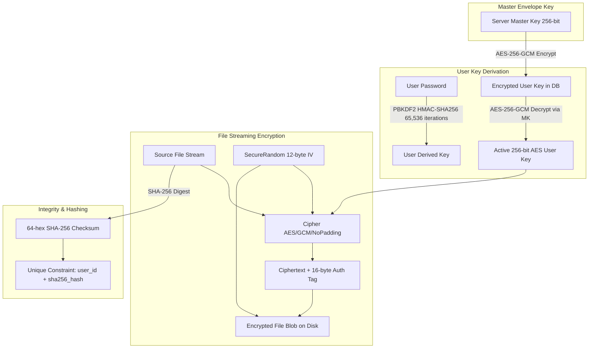

# CIPHERVAULT — SECURITY, CRYPTOGRAPHY & DATA INTEGRITY REFERENCE

**Document ID:** `CIPHERVAULT_SECURITY_AND_ENCRYPTION.md`  
**Location:** `docs/reference/CIPHERVAULT_SECURITY_AND_ENCRYPTION.md`  
**Security Standard:** Zero-Knowledge Envelope Encryption with Client-Verified SHA-256 Integrity  
**Cipher Suite:** `AES/GCM/NoPadding` (256-bit Key, 96-bit Random Nonce/IV, 128-bit Authentication Tag)  

---

## 1. Cryptographic Architecture

---

## 2. Encryption Implementation Details

### 2.1 AES-256-GCM Streaming Cipher
- **Algorithm:** AES (Advanced Encryption Standard) in Galois/Counter Mode (GCM).
- **Key Length:** 256 bits (`SecretKeySpec(keyBytes, "AES")`).
- **Initialization Vector (IV / Nonce):**
  - Length: 12 bytes (96 bits) as recommended by NIST SP 800-38D.
  - Source: Cryptographically secure pseudo-random number generator (`SecureRandom`).
  - Storage: Prepended to the beginning of the ciphertext file stream.
- **Authentication Tag:**
  - Length: 128 bits (16 bytes).
  - Validation: Computed by GCM and automatically verified during streaming decryption.
  - Failure Behavior: Any bit tampering or payload corruption triggers `AEADBadTagException`. Decryption is halted immediately and zero bytes of unverified plaintext are returned.

### 2.2 Envelope Key Derivation & Management
- Each user possesses a unique 256-bit data encryption key (`userKey`).
- New keys are generated via `KeyGenerator.getInstance("AES")` with 256-bit strength.
- User keys are stored in the `users.user_key` column encrypted under the system `CIPHERVAULT_MASTER_KEY` using AES-256-GCM.
- In memory, keys are cleared when requests complete.

### 2.3 Streaming IO Architecture
- **Chunk Size:** 16 KB (`16 * 1024` bytes) buffer size prevents out-of-memory errors on large uploads (up to the 1 GB batch limit).
- **Decrypted Streaming:** Download endpoints stream decrypted bytes directly through `StreamingResponseBody` to the client socket without buffering the full decrypted file onto server disk.

---

## 3. Data Integrity & Deduplication

### 3.1 SHA-256 Checksumming
- Calculated directly from the raw unencrypted file stream before encryption commences.
- Format: 64-character lowercase hexadecimal string (`HexFormat.of().formatHex(digest)`).
- Sent in the `X-File-SHA256` HTTP header on download so the Android client verifies file integrity after local decryption.

### 3.2 User-Scoped Deduplication
- Database enforces `UNIQUE KEY uq_stored_files_user_sha256 (user_id, sha256_hash)`.
- If a user uploads a file with an identical SHA-256 hash, the upload is rejected with `DuplicateFileException` (HTTP 409 Conflict).
- **Tenant Isolation:** Deduplication is strictly user-scoped. Different users can independently store identical files without knowledge of other users' data, preventing cross-user information leakage.

---

## 4. Authentication, Session & Access Control

### 4.1 Password Hashing
- **Algorithm:** BCrypt with work factor / cost `12`.
- Salts are automatically generated and embedded per password hash.
- Verified in `AuthController` via `PasswordEncoder.matches()`.

### 4.2 JWT Lifecycle & Token Revocation
- **Algorithm:** HMAC-SHA256 signed using `ciphervault.jwt.secret`.
- **Claims:**
  - `sub`: User email address.
  - `tokenVersion`: Integer matching `users.token_version`.
  - `iat`: Timestamp issued.
  - `exp`: Expiration (default 24 hours).
- **Instant Revocation:**
  - When a user logs out (`POST /api/auth/logout`) or changes their password (`POST /api/auth/change-password`), `user.token_version` is incremented.
  - `JwtAuthenticationFilter` compares the token's `tokenVersion` claim against the database. Stale tokens are immediately rejected with HTTP 401.

### 4.3 Brute-Force Rate Limiting
- `LoginRateLimiterService` tracks failed attempts by client IP and identifier.
- 5 consecutive failed attempts initiates a 15-minute account lockout.
- Server returns HTTP 429 Too Many Requests with header `Retry-After: 900`.

### 4.4 Tenant Ownership Scoping
Every endpoint interacting with files (`/api/files`, `/api/files/{id}`, `/api/files/{id}/download`, `/api/files/{id}/preview`, `/api/files/search`, `/api/files/facets`) queries the database using `WHERE user_id = :authenticatedUserId`.
- Client-supplied IDs are never trusted to imply ownership.
- Cross-tenant access attempts return HTTP 404 Not Found to prevent ID enumeration.

---

## 5. Storage Quota & Resource Exhaustion Defense

1. **Authoritative Quota (10 GB):**
   - Verified atomically at the database engine level via `userRepository.incrementStorageUsedAtomic`.
   - SQL query: `UPDATE users SET used_storage = used_storage + :delta WHERE id = :userId AND (used_storage + :delta) <= storage_limit`.
   - Prevents race conditions during concurrent multi-part uploads.
2. **Batch Limit (1 GB):**
   - Individual files and total staged upload batches are capped at 1,073,741,824 bytes.
3. **Path Traversal Defense:**
   - All relative file paths are resolved against `FileStorageConfig.STORAGE_ROOT.toAbsolutePath().normalize()`.
   - Paths attempting to navigate outside the storage root trigger a `SecurityException`.
4. **Temporary File Hygiene:**
   - Temporary upload staging files are created via `Files.createTempFile` and cleaned in `finally` blocks upon both success and failure.

