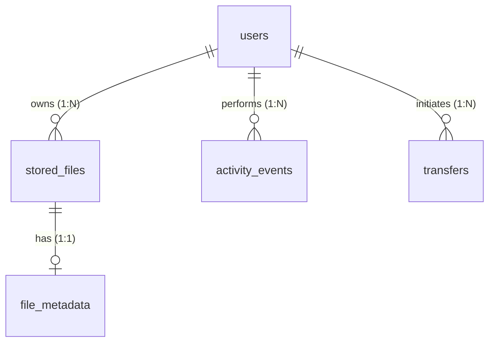

# CipherVault — Authoritative Database Schema Reference

This document provides the authoritative, evidence-verified database dictionary for CipherVault. The schema was inspected directly from [`database/schema.sql`](file:///c:/Users/akhil/OneDrive/Desktop/CipherVault/database/schema.sql) and cross-verified against the JPA entity classes in `backend/src/main/java/com/ciphervault/ciphervault/`.

Database Engine: **MySQL 8.0+ (InnoDB)**  
Default Character Set: `utf8mb4`  
Collation: `utf8mb4_unicode_ci`  
Database Name: `ciphervault`

---

## 1. Table Inventory and Purpose

| Table Name | Entity Class | Primary Responsibility | Enforced Relationships |
| :--- | :--- | :--- | :--- |
| **`users`** | [`User.java`](file:///c:/Users/akhil/OneDrive/Desktop/CipherVault/backend/src/main/java/com/ciphervault/ciphervault/user/User.java) | Manages user accounts, authentication credentials, envelope encryption keys (UDEKs), and storage quotas. | Parent table for stored files, activities, and transfers. |
| **`stored_files`** | [`StoredFile.java`](file:///c:/Users/akhil/OneDrive/Desktop/CipherVault/backend/src/main/java/com/ciphervault/ciphervault/file/StoredFile.java) | Records file metadata, physical filesystem paths, SHA-256 integrity digests, and encryption status. | `user_id` FK &rarr; `users(id)` (`ON DELETE CASCADE`). |
| **`file_metadata`** | [`FileMetadata.java`](file:///c:/Users/akhil/OneDrive/Desktop/CipherVault/backend/src/main/java/com/ciphervault/ciphervault/file/FileMetadata.java) | Stores rich forensic media metadata (camera optics, EXIF, audio/video codecs, document properties). | `file_id` FK &rarr; `stored_files(id)` (`ON DELETE CASCADE`). |
| **`activity_events`** | [`ActivityEvent.java`](file:///c:/Users/akhil/OneDrive/Desktop/CipherVault/backend/src/main/java/com/ciphervault/ciphervault/activity/ActivityEvent.java) | Audits security events (registration, login, upload, download, duplicate rejection, deletion). | `user_id` FK &rarr; `users(id)` (`ON DELETE CASCADE`). |
| **`transfers`** | [`Transfer.java`](file:///c:/Users/akhil/OneDrive/Desktop/CipherVault/backend/src/main/java/com/ciphervault/ciphervault/transfer/Transfer.java) | Audits streaming upload and download throughput, batch identifiers, byte counters, and statuses. | `user_id` FK &rarr; `users(id)` (`ON DELETE CASCADE`). |

---

## 2. Exhaustive Table Specifications

### 2.1 Table: `users`
Manages user identity, credentials, PBKDF2/AES envelope key storage, and atomic storage quotas.

| Column Name | Data Type | Nullable | Key / Constraint | Default Value | Description / Operational Purpose |
| :--- | :--- | :---: | :---: | :---: | :--- |
| `id` | `BIGINT` | **NO** | **PK** (Auto Inc) | Auto | Unique surrogate user identifier. |
| `name` | `VARCHAR(255)` | **NO** | — | — | Full display name of the user. |
| `username` | `VARCHAR(255)` | **NO** | **UNIQUE** | — | Unique handle for user login and mention. |
| `email` | `VARCHAR(255)` | **NO** | **UNIQUE** | — | Unique user email address (login identifier). |
| `password` | `VARCHAR(255)` | **NO** | — | — | BCrypt password hash (cost factor 10). |
| `storage_limit`| `BIGINT` | **NO** | — | `10737418240` | Total storage limit in bytes (**10 GB**). |
| `used_storage` | `BIGINT` | **NO** | — | `0` | Bytes consumed by user's active files. |
| `user_key` | `VARCHAR(512)`| YES | — | `NULL` | Base64-encoded UDEK wrapped by Server KEK. |
| `token_version`| `INT` | **NO** | — | `1` | Incremented on logout/password reset to revoke JWTs. |
| `profile_photo_path` | `VARCHAR(512)` | YES | — | `NULL` | Relative storage path to custom avatar image. |
| `created_at` | `DATETIME` | **NO** | — | `CURRENT_TIMESTAMP` | Account creation timestamp. |

* **Indexes:** `idx_users_username` on `(username)`, `idx_users_email` on `(email)`.

---

### 2.2 Table: `stored_files`
Manages user vault file records, physical filesystem mappings, SHA-256 hashes, and encryption state.

| Column Name | Data Type | Nullable | Key / Constraint | Default Value | Description / Operational Purpose |
| :--- | :--- | :---: | :---: | :---: | :--- |
| `id` | `BIGINT` | **NO** | **PK** (Auto Inc) | Auto | Unique surrogate stored file identifier. |
| `user_id` | `BIGINT` | **NO** | **FK** | — | References `users(id)` with `ON DELETE CASCADE`. |
| `original_filename` | `VARCHAR(255)` | **NO** | — | — | Original filename preserved for download/UI. |
| `stored_filename` | `VARCHAR(255)` | **NO** | — | — | UUID-based physical filename on disk. |
| `file_size` | `BIGINT` | **NO** | — | — | Exact file size in bytes (max 1 GB per file). |
| `content_type` | `VARCHAR(255)` | **NO** | — | — | Detected MIME type (e.g., `image/jpeg`). |
| `sha256_hash` | `VARCHAR(64)` | **NO** | — | — | 64-character hex SHA-256 digest of plaintext. |
| `storage_path` | `VARCHAR(512)` | **NO** | — | — | Relative disk path (`storage/encrypted/...` or `storage/uploads/...`). |
| `encrypted` | `BOOLEAN` | **NO** | — | `TRUE` | `TRUE` if encrypted with AES-256-GCM; `FALSE` if unencrypted. |
| `has_preview` | `BOOLEAN` | **NO** | — | `FALSE` | `TRUE` if thumbnail preview was generated. |
| `preview_path` | `VARCHAR(512)` | YES | — | `NULL` | Path to generated preview thumbnail (`storage/previews/...`). |
| `preview_mime_type` | `VARCHAR(100)` | YES | — | `NULL` | MIME type of preview image (e.g., `image/jpeg`). |
| `created_at` | `DATETIME` | **NO** | — | `CURRENT_TIMESTAMP` | File upload timestamp. |

* **Constraints:**
  - Foreign Key: `CONSTRAINT fk_stored_files_user FOREIGN KEY (user_id) REFERENCES users(id) ON DELETE CASCADE`.
  - Deduplication: `CONSTRAINT uq_stored_files_user_sha256 UNIQUE (user_id, sha256_hash)`.
* **Indexes:** `idx_files_user`, `idx_files_user_created`, `idx_files_user_size`, `idx_files_user_sha256`.

---

### 2.3 Table: `file_metadata`
Stores decoupled forensic metadata extracted via ExifTool before encryption.

| Column Name | Data Type | Nullable | Key / Constraint | Default Value | Description / Operational Purpose |
| :--- | :--- | :---: | :---: | :---: | :--- |
| `id` | `BIGINT` | **NO** | **PK** (Auto Inc) | Auto | Unique surrogate metadata record ID. |
| `file_id` | `BIGINT` | **NO** | **FK, UNIQUE** | — | 1:1 reference to `stored_files(id)` (`ON DELETE CASCADE`). |
| `camera_make` | `VARCHAR(255)` | YES | — | `NULL` | Camera manufacturer (e.g., `Google`, `Sony`). |
| `camera_model`| `VARCHAR(255)` | YES | — | `NULL` | Camera model (e.g., `Pixel 8 Pro`). |
| `lens` | `VARCHAR(255)` | YES | — | `NULL` | Lens hardware description. |
| `focal_length`| `VARCHAR(100)` | YES | — | `NULL` | Lens focal length (e.g., `6.9 mm`). |
| `iso` | `VARCHAR(50)` | YES | — | `NULL` | ISO camera sensitivity setting (e.g., `100`). |
| `exposure_time`| `VARCHAR(100)`| YES | — | `NULL` | Shutter speed (e.g., `1/250s`). |
| `f_number` | `VARCHAR(50)` | YES | — | `NULL` | Lens aperture rating (e.g., `f/1.68`). |
| `date_taken` | `VARCHAR(100)` | YES | — | `NULL` | Original photo capture date/time. |
| `width` | `INT` | YES | — | `NULL` | Media frame pixel width. |
| `height` | `INT` | YES | — | `NULL` | Media frame pixel height. |
| `resolution` | `VARCHAR(100)` | YES | — | `NULL` | Formatted resolution (e.g., `4032x3024`). |
| `duration` | `VARCHAR(100)` | YES | — | `NULL` | Audio/Video playback duration. |
| `video_codec` | `VARCHAR(100)` | YES | — | `NULL` | Video encoding standard (e.g., `H.264`, `HEVC`). |
| `audio_codec` | `VARCHAR(100)` | YES | — | `NULL` | Audio encoding standard (e.g., `AAC`, `FLAC`). |
| `frame_rate` | `VARCHAR(50)` | YES | — | `NULL` | Video frame rate (e.g., `60 fps`). |
| `bitrate` | `VARCHAR(100)` | YES | — | `NULL` | Media data streaming bitrate. |
| `title` | `VARCHAR(255)` | YES | — | `NULL` | Embedded media/document title. |
| `artist` | `VARCHAR(255)` | YES | — | `NULL` | Music artist / audio creator. |
| `album` | `VARCHAR(255)` | YES | — | `NULL` | Audio album title. |
| `genre` | `VARCHAR(100)` | YES | — | `NULL` | Audio genre classification. |
| `release_year`| `VARCHAR(50)` | YES | — | `NULL` | Media release year. |
| `author` | `VARCHAR(255)` | YES | — | `NULL` | Document author (PDF, DOCX). |
| `creator` | `TEXT` | YES | — | `NULL` | Application or library that created the asset. |
| `subject` | `TEXT` | YES | — | `NULL` | Document subject summary. |
| `keywords` | `TEXT` | YES | — | `NULL` | Embedded document search tags. |
| `doc_created_date` | `VARCHAR(100)` | YES | — | `NULL` | Document creation timestamp. |
| `doc_modified_date`| `VARCHAR(100)` | YES | — | `NULL` | Document modification timestamp. |
| `raw_metadata_json`| `TEXT` | YES | — | `NULL` | Complete raw JSON dump from ExifTool. |

* **Constraints:**
  - `CONSTRAINT fk_file_metadata_stored_file FOREIGN KEY (file_id) REFERENCES stored_files(id) ON DELETE CASCADE`.
  - `UNIQUE (file_id)`.
* **Indexes:** `idx_meta_make`, `idx_meta_model`, `idx_meta_resolution`, `idx_meta_vcodec`, `idx_meta_artist`, `idx_meta_album`, `idx_meta_genre`, `idx_meta_author`, `idx_meta_title`.

---

### 2.4 Table: `activity_events`
Audits security lifecycle events and user operations.

| Column Name | Data Type | Nullable | Key / Constraint | Default Value | Description / Operational Purpose |
| :--- | :--- | :---: | :---: | :---: | :--- |
| `id` | `BIGINT` | **NO** | **PK** (Auto Inc) | Auto | Unique surrogate event identifier. |
| `user_id` | `BIGINT` | **NO** | **FK** | — | References `users(id)` with `ON DELETE CASCADE`. |
| `event_type` | `VARCHAR(50)` | **NO** | — | — | Event enum (e.g., `LOGIN`, `UPLOAD`, `DOWNLOAD`, `DELETE`, `DUPLICATE_DETECTED`). |
| `timestamp` | `DATETIME` | **NO** | — | `CURRENT_TIMESTAMP` | Event timestamp. |
| `summary` | `VARCHAR(500)` | YES | — | `NULL` | Human-readable event description. |
| `file_count` | `INT` | YES | — | `NULL` | Number of files affected in this operation. |
| `total_bytes`| `BIGINT` | YES | — | `NULL` | Total bytes transferred or manipulated. |
| `affected_files` | `TEXT` | YES | — | `NULL` | Comma-separated list or JSON array of affected filenames. |
| `status` | `VARCHAR(50)` | YES | — | `NULL` | Outcome status (e.g., `SUCCESS`, `REJECTED`, `FAILED`). |
| `error_message` | `VARCHAR(500)`| YES | — | `NULL` | Error details if operation failed. |

* **Constraints:** `CONSTRAINT fk_activity_events_user FOREIGN KEY (user_id) REFERENCES users(id) ON DELETE CASCADE`.
* **Indexes:** `idx_activity_user`, `idx_activity_user_time`, `idx_activity_user_type`.

---

### 2.5 Table: `transfers`
Audits background streaming transfer batches and throughput history.

| Column Name | Data Type | Nullable | Key / Constraint | Default Value | Description / Operational Purpose |
| :--- | :--- | :---: | :---: | :---: | :--- |
| `id` | `BIGINT` | **NO** | **PK** (Auto Inc) | Auto | Unique surrogate transfer record ID. |
| `user_id` | `BIGINT` | **NO** | **FK** | — | References `users(id)` with `ON DELETE CASCADE`. |
| `transfer_type` | `VARCHAR(50)` | **NO** | — | — | Transfer direction: `UPLOAD` or `DOWNLOAD`. |
| `status` | `VARCHAR(50)` | **NO** | — | — | State: `IN_PROGRESS`, `COMPLETED`, `FAILED`, `CANCELLED`. |
| `total_bytes` | `BIGINT` | YES | — | `NULL` | Expected transfer size in bytes. |
| `transferred_bytes`| `BIGINT` | YES | — | `NULL` | Bytes successfully transferred so far. |
| `file_ids` | `VARCHAR(255)` | YES | — | `NULL` | Identifiers of files included in transfer. |
| `file_names` | `TEXT` | YES | — | `NULL` | Names of files included in transfer. |
| `batch_identifier` | `VARCHAR(100)` | YES | — | `NULL` | Unique UUID grouping batch transfer chunks. |
| `error_message` | `VARCHAR(500)` | YES | — | `NULL` | Failure diagnostic if aborted. |
| `started_at` | `DATETIME` | **NO** | — | `CURRENT_TIMESTAMP` | Transfer start timestamp. |
| `completed_at` | `DATETIME` | YES | — | `NULL` | Completion timestamp. |
| `updated_at` | `DATETIME` | **NO** | — | `CURRENT_TIMESTAMP ON UPDATE` | Last status update timestamp. |

* **Constraints:** `CONSTRAINT fk_transfers_user FOREIGN KEY (user_id) REFERENCES users(id) ON DELETE CASCADE`.
* **Indexes:** `idx_transfers_user`, `idx_transfers_user_type`, `idx_transfers_user_time`, `idx_transfers_user_status`.

---

## 3. Entity-Relationship Cardinalities

1. **`users` &rarr; `stored_files` (One-to-Many / 1:N):** One user can own zero or many stored files. Each stored file belongs to exactly one user. Enforced by `stored_files.user_id` referencing `users.id` with `ON DELETE CASCADE`.
2. **`stored_files` &rarr; `file_metadata` (One-to-One / 1:1):** Each stored file has at most one rich forensic metadata record. Enforced by foreign key `file_metadata.file_id` referencing `stored_files.id` with `UNIQUE (file_id)` and `ON DELETE CASCADE`.
3. **`users` &rarr; `activity_events` (One-to-Many / 1:N):** One user can perform multiple audited security and file operations. Enforced by `activity_events.user_id` referencing `users.id` with `ON DELETE CASCADE`.
4. **`users` &rarr; `transfers` (One-to-Many / 1:N):** One user can initiate multiple upload and download streaming batches. Enforced by `transfers.user_id` referencing `users.id` with `ON DELETE CASCADE`.

---

## 4. Key Architectural Insights & Differences from First-Review

1. **Table Renaming:** The previous first-review presentation depicted tables named `files` and `activity_log`. The authoritative schema uses `stored_files` and `activity_events`.
2. **Deduplication Scope:** The unique constraint `uq_stored_files_user_sha256 (user_id, sha256_hash)` guarantees that deduplication is per-user, preventing cross-user side-channel confirmation attacks.
3. **Forensic Metadata Support:** `file_metadata` contains 29 columns of detailed camera optics, video/audio codecs, and document tags extracted by ExifTool, enabling multi-facet search.
4. **Transfer Auditing:** `transfers` was added to record live streaming throughput and historical transfer batches.
